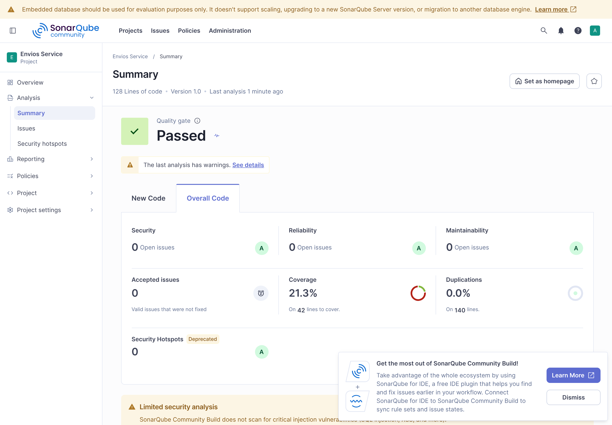
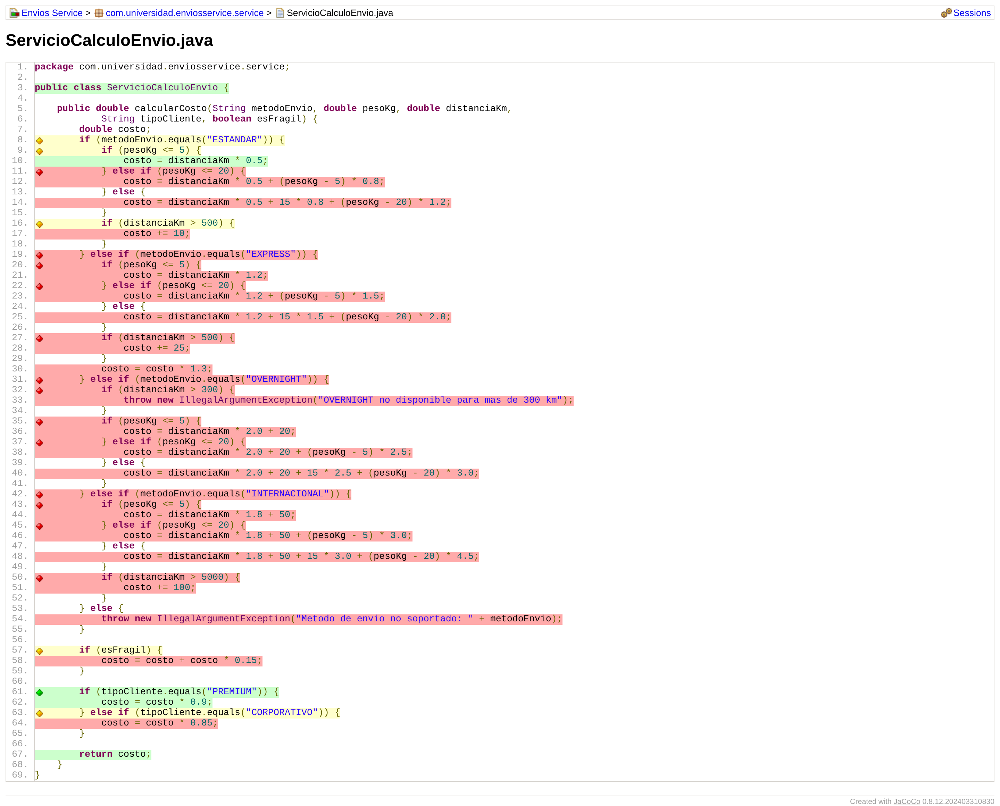

# Envios Service — Análisis de Métricas de Calidad

Post-contenido U10 · Patrones de Diseño de Software (UFPS). Proyecto Maven plano que calcula el costo de un envío según método, peso, distancia, fragilidad y tipo de cliente, analizado con SonarQube y JaCoCo.

## Cómo ejecutarlo

```bash
docker run -d --name sonarqube -p 9000:9000 -e SONAR_ES_BOOTSTRAP_CHECKS_DISABLE=true sonarqube:community
mvn clean verify                                   # pruebas + target/site/jacoco/
mvn clean verify sonar:sonar -Dsonar.token=TOKEN   # análisis en http://localhost:9000
```

## Entorno de análisis

**Decisión de diseño 1: SonarQube Community local con Docker.**
- **Sin depender de un plan gratuito ni de la visibilidad pública:** con SonarCloud, el proyecto quedaría expuesto como público y el análisis dependería de la cuenta y de la conexión. En local controlo la configuración completa: puedo crear el Quality Profile y el Quality Gate sin las restricciones del plan gratuito.
- **Costo asumido:** el contenedor consume recursos (alrededor de 2 GB de RAM con Elasticsearch embebido) y tiene que seguir corriendo durante todo el laboratorio. Además usa la base H2 embebida, que SonarQube solo recomienda para evaluación. Para un laboratorio de un solo proyecto eso basta.
- Versión usada: SonarQube Community Build **26.11** (imagen `sonarqube:community`).

## Exclusiones del análisis

**Decisión de diseño 2: no se excluye nada.** El proyecto no tiene clase `Main`, DTOs generados ni código de infraestructura: todo `src/main/java` es lógica de negocio. Excluir algo solo maquillaría el porcentaje de cobertura. La línea `sonar.exclusions` queda comentada en `sonar-project.properties` para dejar constancia de la decisión.

## Estado inicial del análisis

Valores leídos del dashboard y de la API de SonarQube tras el primer `mvn clean verify sonar:sonar`, y del `jacoco.xml`:

| Métrica | Valor real observado |
|---------|----------------------|
| Complejidad ciclomática de `calcularCosto()` | **20** (JaCoCo, contador `COMPLEXITY` del método; SonarQube reporta 20 para el archivo, que tiene un solo método) |
| Complejidad cognitiva de `ServicioCalculoEnvio` | 32 |
| Cobertura de líneas de `ServicioCalculoEnvio` | **23,8 %** (32 de 42 líneas sin cubrir) |
| Cobertura de ramas de `ServicioCalculoEnvio` | **18,4 %** (7 de 38 condiciones cubiertas) |
| Cobertura global (Sonar) | 21,3 % |
| Code Smells reportados | **0** |
| Quality Gate (Sonar way por defecto) | Passed |

### Por qué hay 0 Code Smells con un método de CC 20

No es un error de lectura. En SonarQube 26.11, el perfil por defecto de Java es **"Sonar way core"** (263 reglas), que **no activa** ni la S3776 (complejidad cognitiva, umbral 15) ni la S1541 (complejidad ciclomática). Ese perfil solo trae reglas de bugs y vulnerabilidades más una base mínima de mantenibilidad. Con él, el método más complejo del proyecto no genera ningún hallazgo, y el Quality Gate por defecto pasa aunque la cobertura sea del 21 %. Esta es justamente la razón de configurar el perfil propio "Estándar Laboratorio" en la Parte 2.

## Interpretación

- **Método que concentra el problema:** `ServicioCalculoEnvio.calcularCosto()`. Es el único método de la clase y suma sus 20 de complejidad ciclomática: 1 de base, 4 de la cadena `ESTANDAR/EXPRESS/OVERNIGHT/INTERNACIONAL`, 12 de los tramos de peso (3 por método) y de los recargos o límites de distancia dentro de cada método, 1 de la fragilidad y 2 de `PREMIUM/CORPORATIVO`. En `Measures → Complexity`, SonarQube muestra 20 para el archivo (ver captura). El valor exacto por método sale del reporte de JaCoCo.
- **Ramas sin cubrir según JaCoCo** (rojo y amarillo en la captura):
  - ESTANDAR: los tramos `5 < peso ≤ 20` (línea 12) y `peso > 20` (línea 14), y el recargo por `distancia > 500` (línea 17).
  - EXPRESS, OVERNIGHT e INTERNACIONAL: ninguna línea ejecutada, ni siquiera la condición que los selecciona (líneas 19-51). Eso incluye la excepción de OVERNIGHT para más de 300 km y el recargo de INTERNACIONAL para más de 5000 km.
  - El `else` de método no soportado (línea 54).
  - `esFragil == true` (línea 58) y el descuento `CORPORATIVO` (línea 64).
- **¿Coinciden CC alta y cobertura baja?** Sí, en `calcularCosto()`. Coinciden por construcción: al concentrar toda la lógica en un solo método, cada punto de decisión es una rama más que probar, y las 2 pruebas iniciales recorren un solo camino (ESTANDAR, peso bajo, distancia corta) con 2 tipos de cliente. Con 20 caminos independientes y 2 pruebas, la cobertura de ramas no podía salir alta.

**Decisión de diseño 3: la señal principal es la complejidad ciclomática.** Las tres señales apuntan al mismo método, pero la CC es la que manda en este caso:
- mide directamente el número de caminos independientes, es decir, el mínimo de pruebas que necesita una suite completa. Ese es el problema que la Parte 2 tiene que atacar;
- es la métrica que un patrón como Strategy reduce de forma verificable, porque saca ramas del método a clases separadas;
- la cobertura baja es un síntoma de la CC alta y no al revés: subirla con más pruebas sin refactorizar dejaría un método con 20 caminos igual de frágil ante cambios;
- la complejidad cognitiva (32) confirma el diagnóstico, porque penaliza el anidamiento de los `if`. Pero la Tabla 3.2 de la guía y la regla S1541 que se configura después trabajan con la ciclomática, así que esa es la que se compara antes y después.

## Capturas del análisis inicial




