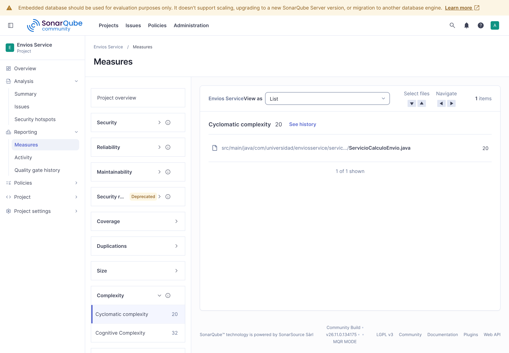

# Envios Service — Análisis de Métricas de Calidad

Post-contenido U10 · Patrones de Diseño de Software (UFPS). Proyecto Maven plano que calcula el costo de un envío según método, peso, distancia, fragilidad y tipo de cliente, analizado con SonarQube y JaCoCo.

## Cómo ejecutarlo

```bash
docker run -d --name sonarqube -p 9000:9000 -e SONAR_ES_BOOTSTRAP_CHECKS_DISABLE=true sonarqube:community
mvn clean verify                                   # pruebas + target/site/jacoco/
mvn clean verify sonar:sonar -Dsonar.token=TOKEN   # análisis en http://localhost:9000
```

## Entorno de análisis

**Decisión de diseño 1: SonarQube Community local con Docker.**
- **Sin depender de un plan gratuito ni de la visibilidad pública:** con SonarCloud, el proyecto quedaría expuesto como público y el análisis dependería de la cuenta y de la conexión. En local controlo la configuración completa: puedo crear el Quality Profile y el Quality Gate sin las restricciones del plan gratuito.
- **Costo asumido:** el contenedor consume recursos (alrededor de 2 GB de RAM con Elasticsearch embebido) y tiene que seguir corriendo durante todo el laboratorio. Además usa la base H2 embebida, que SonarQube solo recomienda para evaluación. Para un laboratorio de un solo proyecto eso basta.
- Versión usada: SonarQube Community Build **26.11** (imagen `sonarqube:community`).

## Exclusiones del análisis

**Decisión de diseño 2: no se excluye nada.** El proyecto no tiene clase `Main`, DTOs generados ni código de infraestructura: todo `src/main/java` es lógica de negocio. Excluir algo solo maquillaría el porcentaje de cobertura. La línea `sonar.exclusions` queda comentada en `sonar-project.properties` para dejar constancia de la decisión.

## Estado inicial del análisis

Valores leídos del dashboard y de la API de SonarQube tras el primer `mvn clean verify sonar:sonar`, y del `jacoco.xml`:

| Métrica | Valor real observado |
|---------|----------------------|
| Complejidad ciclomática de `calcularCosto()` | **20** (JaCoCo, contador `COMPLEXITY` del método; SonarQube reporta 20 para el archivo, que tiene un solo método) |
| Complejidad cognitiva de `ServicioCalculoEnvio` | 32 |
| Cobertura de líneas de `ServicioCalculoEnvio` | **23,8 %** (32 de 42 líneas sin cubrir) |
| Cobertura de ramas de `ServicioCalculoEnvio` | **18,4 %** (7 de 38 condiciones cubiertas) |
| Cobertura global (Sonar) | 21,3 % |
| Code Smells reportados | **0** |
| Quality Gate (Sonar way por defecto) | Passed |

### Por qué hay 0 Code Smells con un método de CC 20

No es un error de lectura. En SonarQube 26.11, el perfil por defecto de Java es **"Sonar way core"** (263 reglas), que **no activa** ni la S3776 (complejidad cognitiva, umbral 15) ni la S1541 (complejidad ciclomática). Ese perfil solo trae reglas de bugs y vulnerabilidades más una base mínima de mantenibilidad. Con él, el método más complejo del proyecto no genera ningún hallazgo, y el Quality Gate por defecto pasa aunque la cobertura sea del 21 %. Esta es justamente la razón de configurar el perfil propio "Estándar Laboratorio" en la Parte 2.

## Interpretación

- **Método que concentra el problema:** `ServicioCalculoEnvio.calcularCosto()`. Es el único método de la clase y suma sus 20 de complejidad ciclomática: 1 de base, 4 de la cadena `ESTANDAR/EXPRESS/OVERNIGHT/INTERNACIONAL`, 12 de los tramos de peso (3 por método) y de los recargos o límites de distancia dentro de cada método, 1 de la fragilidad y 2 de `PREMIUM/CORPORATIVO`. En `Measures → Complexity`, SonarQube muestra 20 para el archivo (ver captura). El valor exacto por método sale del reporte de JaCoCo.
- **Ramas sin cubrir según JaCoCo** (rojo y amarillo en la captura):
  - ESTANDAR: los tramos `5 < peso ≤ 20` (línea 12) y `peso > 20` (línea 14), y el recargo por `distancia > 500` (línea 17).
  - EXPRESS, OVERNIGHT e INTERNACIONAL: ninguna línea ejecutada, ni siquiera la condición que los selecciona (líneas 19-51). Eso incluye la excepción de OVERNIGHT para más de 300 km y el recargo de INTERNACIONAL para más de 5000 km.
  - El `else` de método no soportado (línea 54).
  - `esFragil == true` (línea 58) y el descuento `CORPORATIVO` (línea 64).
- **¿Coinciden CC alta y cobertura baja?** Sí, en `calcularCosto()`. Coinciden por construcción: al concentrar toda la lógica en un solo método, cada punto de decisión es una rama más que probar, y las 2 pruebas iniciales recorren un solo camino (ESTANDAR, peso bajo, distancia corta) con 2 tipos de cliente. Con 20 caminos independientes y 2 pruebas, la cobertura de ramas no podía salir alta.

**Decisión de diseño 3: la señal principal es la complejidad ciclomática.** Las tres señales apuntan al mismo método, pero la CC es la que manda en este caso:
- mide directamente el número de caminos independientes, es decir, el mínimo de pruebas que necesita una suite completa. Ese es el problema que la Parte 2 tiene que atacar;
- es la métrica que un patrón como Strategy reduce de forma verificable, porque saca ramas del método a clases separadas;
- la cobertura baja es un síntoma de la CC alta y no al revés: subirla con más pruebas sin refactorizar dejaría un método con 20 caminos igual de frágil ante cambios;
- la complejidad cognitiva (32) confirma el diagnóstico, porque penaliza el anidamiento de los `if`. Pero la Tabla 3.2 de la guía y la regla S1541 que se configura después trabajan con la ciclomática, así que esa es la que se compara antes y después.

## Capturas del análisis inicial





---

# Parte 2: Refactorización guiada por métricas

## Decisión de diseño 4: patrón elegido, Strategy

Se revisó cada condicional de `calcularCosto()` contra la tabla de la guía:

| Pregunta | Respuesta en este método | Consecuencia |
|---|---|---|
| ¿Guarda estado entre llamadas que condicione el comportamiento futuro? | No. `ServicioCalculoEnvio` no tiene campos mutables: cada llamada depende solo de sus 5 parámetros. | **Descarta State**: no hay estado ni transiciones que modelar. |
| ¿Hay una secuencia de responsables donde el orden importa y varios podrían aplicar? | No. `metodoEnvio` toma un solo valor y exactamente una rama aplica. Reordenar `ESTANDAR/EXPRESS/...` no cambia ningún resultado. | **Descarta Chain of Responsibility**: no hay cadena; hay una selección. |
| ¿Cada rama calcula el mismo tipo de resultado con su propia fórmula, elegida una vez por un valor discreto? | Sí. Las 4 ramas devuelven un costo base a partir de `(pesoKg, distanciaKm)`, cada una con sus tarifas, recargos y límites. | **Strategy**: un algoritmo intercambiable por valor de `metodoEnvio`. |

**Qué se movió y qué se quedó:**
- **A las estrategias** (`estrategia/`): la fórmula de cada método, es decir, la tarifa por km, el cargo fijo, las tarifas por tramo de peso, el recargo por distancia (500 km o 5000 km), el factor 1,3 de EXPRESS y el rechazo de OVERNIGHT para más de 300 km.
- **Se quedó en el orquestador** (`service/ServicioCalculoEnvio`): la selección (`Map<String, EstrategiaEnvio>`, que reemplaza la cadena `if/else if`), el rechazo de métodos no soportados, el recargo por fragilidad y los descuentos `PREMIUM/CORPORATIVO`. Esas reglas valen igual para los 4 métodos. Meterlas en cada estrategia duplicaría la misma lógica 4 veces, y un cambio en el descuento corporativo obligaría a tocar 4 clases.
- **`RecargoPorPeso`**, una iteración guiada por el Quality Gate: el primer análisis tras el refactor marcó **11,9 % de líneas duplicadas** entre `EnvioEstandarStrategy` y `EnvioExpressStrategy` (12 líneas con la misma estructura de tramos y otros literales), por encima del 5 % del gate. Los tramos de peso (0-5, 5-20 y más de 20 kg) son la misma regla en los 4 métodos; solo cambian las tarifas. Por eso se extrajeron a un helper `package-private` y cada estrategia aporta sus dos tarifas. Con eso, cada estrategia quedó con CC 2 y la duplicación volvió a 0 %.

Estructura final:

```
src/main/java/com/universidad/enviosservice/
├── service/ServicioCalculoEnvio.java       ← orquestador (CC 5)
└── estrategia/
    ├── EstrategiaEnvio.java                ← interfaz común
    ├── EnvioEstandarStrategy.java          ← CC 2
    ├── EnvioExpressStrategy.java           ← CC 2
    ├── EnvioOvernightStrategy.java         ← CC 2
    ├── EnvioInternacionalStrategy.java     ← CC 2
    └── RecargoPorPeso.java                 ← tramos de peso comunes (CC 3)
```

## Decisión de diseño 5: criterio de las pruebas agregadas

Cada prueba nueva corresponde a una rama que el reporte de JaCoCo de la Parte 1 marcó en rojo o amarillo y verifica un valor distinto, calculado a mano desde la fórmula. Las pruebas en los límites (5 kg, 20 kg, 300 km, 500 km y 5000 km) son las que detectarían un `<=` cambiado por `<`.

| Rama sin cubrir en la Parte 1 (línea del original) | Prueba que la ejercita |
|---|---|
| ESTANDAR `5 < peso ≤ 20` (12) y `peso > 20` (14) | `EnvioEstandarStrategyTest.calculaCostoPorTramoDePeso` (8 kg → 52,4; 25 kg → 68,0; límites 5 kg → 50 y 20 kg → 62) |
| ESTANDAR `distancia > 500` (17) | `EnvioEstandarStrategyTest.aplicaRecargoSoloPorEncimaDe500Km` (500 km → 250 sin recargo; 600 km → 310) |
| Selección y 3 tramos de EXPRESS (19-25) | `EnvioExpressStrategyTest.calculaCostoPorTramoDePeso` (156; 161,85; 198,25) |
| EXPRESS `distancia > 500` y factor 1,3 (27-30) | `EnvioExpressStrategyTest.aplicaRecargoAntesDelFactorExpress` (500 km → 780; 600 km → 968,5: verifica que el +25 se suma antes del ×1,3) |
| OVERNIGHT `distancia > 300` → excepción (32-33) | `EnvioOvernightStrategyTest.rechazaDistanciasMayoresA300Km` (301 km) y `aceptaExactamente300Km` (300 km → 620) |
| 3 tramos de OVERNIGHT (35-40) | `EnvioOvernightStrategyTest.calculaCostoPorTramoDePeso` (220; 227,5; 272,5) |
| 3 tramos de INTERNACIONAL (43-48) | `EnvioInternacionalStrategyTest.calculaCostoPorTramoDePeso` (230; 239; 297,5) |
| INTERNACIONAL `distancia > 5000` (50-51) | `EnvioInternacionalStrategyTest.aplicaRecargoSoloPorEncimaDe5000Km` (5000 km → 9050; 6000 km → 10950) |
| `else` de método no soportado (54) | `ServicioCalculoEnvioTest.rechazaMetodoDeEnvioNoSoportado` (también verifica el mensaje) |
| `esFragil == true` (58) | `ServicioCalculoEnvioTest.aplicaRecargoDel15PorCientoSiEsFragil` (57,5) y `combinaFragilidadYDescuentoEnOrden` (51,75: recargo antes del descuento) |
| `CORPORATIVO` (64) | `ServicioCalculoEnvioTest.aplicaDescuentoClienteCorporativo` (42,5) |
| Selección de cada estrategia desde el servicio | `ServicioCalculoEnvioTest.delegaEnLaFormulaDeCadaMetodoDeEnvio` y `propagaElRechazoDeOvernightPorDistancia` |

**Proceso:** las pruebas de `ServicioCalculoEnvioTest` se escribieron **antes** del refactor y pasaron con el método original (pruebas de caracterización). Así, el refactor se hizo con la red puesta: las 10 pasaron igual antes y después. Las pruebas de estrategias se escribieron antes que las clases y fallaron por no existir (rojo) hasta implementarlas (verde).

**Corrección a la guía:** la guía da `25.0, 100.0, 250.0` para OVERNIGHT, pero su propia fórmula da `100·2,0 + 20 + 15·2,5 + 5·3,0 = 272,5`. La prueba usa 272,5, que es el comportamiento real del método original.

## Decisión de diseño 6: Quality Profile, Quality Gate y realismo del umbral

**Configuración aplicada en SonarQube:**
- **Quality Profile "Estándar Laboratorio"** (Java): copia del perfil por defecto. En SonarQube 26.11 ese perfil se llama **"Sonar way core"**: el "Sonar way" que menciona la guía ya no existe con ese nombre. Sobre la copia se activó **S1541** ("Methods should not be too complex") con **Threshold = 10**, y el perfil se asignó a `envios-service`.
- **Quality Gate "Estándar Laboratorio"**, asignado a `envios-service`, con 3 condiciones: `Coverage < 70 %`, `New Code Smells > 0` y `Duplicated Lines (%) > 5 %`.
  - Al crear un gate, SonarQube 26.11 le agrega por su cuenta 4 condiciones "Clean as You Code" (`new_violations`, `new_coverage < 80`, `new_duplicated_lines_density > 3` y `new_security_hotspots_reviewed`). Se eliminaron para que el gate tenga exactamente las 3 condiciones definidas.
  - La instancia corre en modo MQR (Multi-Quality Rule). `Code Smells` aparece marcada como métrica de la "Standard Experience": sigue funcionando, pero SonarQube sugiere migrarla a `new_maintainability_issues`. Se mantuvo para respetar la guía.

**Por qué CC = 10 por método, y no 5 ni 20:** según la Tabla 3.2 de la guía, 10 es el techo del rango "Moderada" y además es el valor por defecto de la propia regla S1541. Es exigente sin forzar a reescribir métodos que todavía se mantienen bien.
- Con 20, el método original (CC 20 exacto) **no** violaría la regla, y el umbral no detectaría justo el problema que motivó el laboratorio.
- Con 5, el orquestador final (CC 5, todavía en "Moderada") quedaría en el borde, y cualquier regla de negocio nueva, como otro tipo de cliente, lo haría fallar. Eso empujaría a fragmentar el código solo para cumplir el número.

**Por qué 70 % de cobertura, y no 100 %:** 100 % como exigencia es poco realista y genera incentivos perversos (Sección 2.3 de la guía): pruebas que llaman métodos sin verificar nada solo para llenar el número. 70 % es el mismo umbral de la línea `LINE` de JaCoCo en la guía y deja margen para código de infraestructura. Aquí la cobertura final llegó al 100 %, pero como **resultado** de cubrir cada rama con un valor verificado (Decisión 5), no como meta del gate. En un proyecto con clases de arranque o de configuración, el gate seguiría en 70 %.

**Resultado del gate:** el primer análisis tras el refactor falló por `Duplicated Lines (%) = 11,9 % > 5 %` (ver `docs/sonar-dashboard-refactor-gate-fallido.png`). Tras extraer `RecargoPorPeso`, el análisis final **pasa** las 3 condiciones: cobertura 100 %, duplicación 0,0 % y 0 code smells nuevos.
